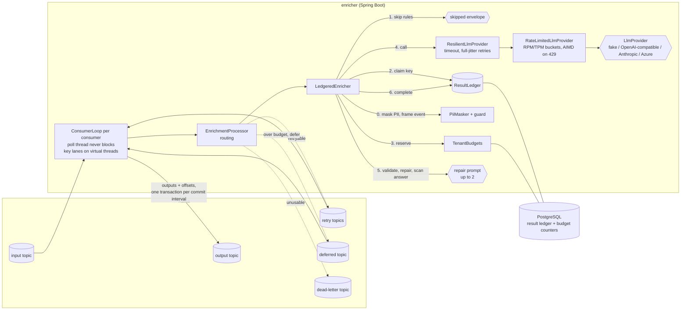

# kafka-llm-enricher

**Add LLM enrichment to a Kafka stream as configuration, not as another hand-written consumer: schema-validated answers, exactly-once output, a PostgreSQL result ledger so rebalances, retries and replays never pay twice for the same event, per-key parallelism that never stalls the poll loop, provider rate limits plus per-tenant budgets so one merchant's burst cannot spend everyone's quota, and card numbers, IBANs, emails and phone numbers masked before any prompt leaves the process.**

> Status: under active development towards `v0.1.0`. Days 1 to 6 of 7 are done: the core engine, the Spring Boot starter, Kafka transactions and the result ledger, a parallel key-ordered consumer loop with retry topics, cost controls (rate limiting with adaptive concurrency, per-tenant budgets, skip rules, cost accounting), output quality and safety (PII masking, an injection guard, schema repair prompts, real OpenAI-compatible, Anthropic and Azure OpenAI providers), and observability and packaging (Prometheus metrics, OpenTelemetry traces from the input record through each model call to the output record, a Grafana dashboard, a Docker image, a `docker compose up` demo and a Helm chart), tested against real Kafka and PostgreSQL. See [docs/PLAN.md](docs/PLAN.md) and [docs/PROGRESS.md](docs/PROGRESS.md).

## The problem

Teams keep writing the same service: read an event (a card dispute note, a merchant descriptor, a support ticket), ask an LLM to classify it or extract fields, and write an enriched event. The naive version:

- pays again for every rebalance, retry and replay;
- falls over on provider 429s, and lets one tenant's burst spend the whole budget;
- blows `max.poll.interval.ms` and breaks per-key ordering;
- lets malformed model output either poison the partition or vanish silently;
- sends customers' card numbers and emails to a third-party model, and lets a dispute note talk the model into a different answer.

kafka-llm-enricher turns that service into a configured pipeline, for teams running Spring Boot, Kafka, PostgreSQL and Kubernetes.

## What a pipeline looks like

```yaml
enricher:
  pipelines:
    dispute-triage:
      input-topic: payments.disputes
      output-topic: payments.disputes.enriched
      dead-letter-topic: payments.disputes.enricher-dlq
      prompt-version: v2
      model: gpt-4o-mini
      output-schema: classpath:schemas/dispute-triage.v1.json
      system-prompt: You triage card payment disputes for a payments operations team.
      user-template: |
        Classify this dispute. Merchant: {{event.merchant}}.
        {{event}}
      # Output quality and safety (these are the defaults)
      mask-pii: pan,iban,email,phone                # [PAN_1], [EMAIL_1], ... in the prompt
      mask-fields: customer.name                    # whole fields to [REDACTED] (default: none)
      prompt-guard: true                            # frames the event as untrusted data
      output-pii: mask                              # or reject (dead-letter) / allow
      repair-attempts: 1                            # one repair prompt for invalid JSON or schema
      # Cost controls (optional)
      tenant: event.merchantId                      # who pays, SpEL over the event
      skip:
        tiny-amount: "event.amount != null and event.amount < 1"   # never sent to the model
      budget:
        period: daily
        max-cost-usd: 50                            # per tenant and day
        tenants:
          big-merchant: { max-cost-usd: 500 }
        on-exceeded: downgrade                      # or defer / skip
        fallback-model: gpt-4o-mini
        after-downgrade: defer                      # park until the budget resets
  provider: openai                                  # fake (default) / openai / anthropic / azure-openai
  providers:
    openai:
      base-url: https://api.openai.com/v1           # or http://localhost:11434/v1 (Ollama), http://vllm:8000/v1
      api-key: ${ENRICHER_OPENAI_API_KEY}
  rate-limit:
    requests-per-minute: 500                        # this instance's share of the key's quota
    tokens-per-minute: 200000
  pricing:
    gpt-4o: { input-per-million: 2.50, output-per-million: 10.00 }
    gpt-4o-mini: { input-per-million: 0.15, output-per-million: 0.60 }
```

The prices above are placeholders: put in what your provider charges you.

An input record such as (a test card number and a made-up address)

```json
{"disputeId":"D-1002","merchant":"Northwind Electronics","amount":349.00,"note":"I did not make this purchase, my card 4111 1111 1111 1111 was used fraudulently. Reach me at jane.doe@example.com."}
```

reaches the model as `... my card [PAN_1] was used fraudulently. Reach me at [EMAIL_1].` and becomes this envelope on the output topic. This is real output from the integration test in CI (run [40196149410](https://github.com/xeeshan16/kafka-llm-enricher/actions/runs/40196149410), printed in the job log), produced by the built-in deterministic fake provider, not an LLM:

```json
{
  "format": "kafka-llm-enricher/v1",
  "pipeline": "dispute-triage",
  "promptVersion": "v2",
  "model": "fake-1",
  "inputHash": "sha256:a125112665a55952fc0d950b38ecee7cf816fd9fab7f7cd06494685148a04578",
  "source": {
    "topic": "payments.disputes",
    "partition": 1,
    "offset": 0,
    "key": "card-1002"
  },
  "input": {
    "disputeId": "D-1002",
    "merchant": "Northwind Electronics",
    "amount": 349.0,
    "note": "I did not make this purchase, my card 4111 1111 1111 1111 was used fraudulently. Reach me at jane.doe@example.com."
  },
  "enrichment": {
    "category": "fraud",
    "customer_requests_refund": false,
    "summary": "I did not make this purchase, my card [PAN_1] was used fraudulently.",
    "urgency": "high"
  },
  "usage": {
    "inputTokens": 240,
    "outputTokens": 38
  }
}
```

The envelope keeps the original `input` for consumers that already have access to the input topic; the prompt and the enrichment carry only placeholders. Token counts from the fake are estimates (four characters per token). The enrichment is written in canonical key order, so an envelope rebuilt from the result ledger is byte-identical to the first one; the `enricher-result-source` header says whether a delivery paid for a model call (`provider`) or reused a stored answer (`ledger`). Records whose answer is still not valid JSON or does not satisfy the schema after the repair prompt go to the dead-letter topic unchanged, with `enricher-failure-reason` (`INVALID_JSON`, `SCHEMA_VIOLATION`, `PII_IN_OUTPUT`, `PROVIDER_ERROR`, `RETRIES_EXHAUSTED`, `LEDGER_BUSY`, `PROCESSING_ERROR`) and `enricher-failure-detail` headers. Records a skip rule matches produce an envelope with `"enrichment": null` and `"skipped": {"reason": "rule:tiny-amount"}` (or nothing, with `emit-skipped: false`), so the output topic can keep one record per input.

## Quick start

Requirements: JDK 21 and Docker.

```bash
git clone https://github.com/xeeshan16/kafka-llm-enricher.git
cd kafka-llm-enricher
./mvnw verify          # unit tests + Kafka/PostgreSQL integration and chaos tests (Testcontainers), no API keys
```

The integration tests start Kafka and PostgreSQL in Docker and run the `dispute-triage` pipeline from `enricher-app/src/main/resources/application.yml`:

- `DisputeTriagePipelineIT` checks the enriched envelopes, the dead-letter path, and that a re-published event is answered from the ledger without a model call.
- `ExactlyOnceChaosIT` runs two instances in one consumer group, aborts transactions after results are stored, and hangs one worker past `max.poll.interval.ms` so it is expelled mid-call. It asserts one committed envelope and one paid call per input.
- `ConcurrencyAndRetryIT` checks per-key order while one call takes longer than `max.poll.interval.ms`, retry-topic delays, and dead-letter reasons for permanent, exhausted and poison records.
- `DisputeTriagePipelineIT` also asserts that a card number and an email in an event never reach the provider, and that an answer missing required fields is fixed by one repair prompt.
- `ObservabilityIT` publishes a dispute inside an upstream trace and checks that the trace continues through `process`, `chat` and `send` spans into the output record's headers, that no span holds the card number, and that the Prometheus scrape has the series the dashboard reads.
- `CostControlIT` runs three tenants against a per-tenant cost cap (downgrade, then defer, never over the cap), a skip rule, free ledger replays for a tenant that is out of budget, and a provider that answers 429 above 3 concurrent calls.

### Run the demo

Requirements: Docker with Compose. No API keys.

```bash
docker compose up -d --build     # Kafka, PostgreSQL, the enricher, Prometheus, Grafana, Jaeger
```

The enricher runs with the `demo` profile ([`application-demo.yml`](enricher-app/src/main/resources/application-demo.yml)): a reproducible stream of synthetic card disputes at 10 per second (public test card numbers, `example.com` emails, 15 % exact replays, a few injection attempts), the fake model with a simulated 150 to 750 ms latency and made-up prices, a skip rule for small amounts, and per-merchant daily budgets with one merchant capped low enough to be downgraded and then deferred within minutes.

| Where | What |
|---|---|
| http://localhost:3000 | Grafana, dashboard "Kafka LLM Enricher" (no login) |
| http://localhost:16686 | Jaeger, service `kafka-llm-enricher`: one trace per record |
| http://localhost:8080/actuator/health | Health, including the consumer loops |
| http://localhost:8080/actuator/prometheus | Raw metrics |
| `localhost:29092` | Kafka from the host |

```bash
docker compose exec kafka /opt/kafka/bin/kafka-console-consumer.sh --bootstrap-server localhost:9092 \
  --topic payments.disputes.enriched --isolation-level read_committed --max-messages 3 --property print.headers=true
scripts/smoke-test.sh            # what CI runs against the same stack
docker compose down -v
```

To try a real model, put for example `ENRICHER_PROVIDER=openai`, `ENRICHER_OPENAI_BASE_URL=http://host.docker.internal:11434/v1` and `ENRICHER_DISPUTE_MODEL=llama3.1:8b` (Ollama) in a `.env` file next to `docker-compose.yml`.

### Use it in your own Spring Boot service

Until the first tagged release (JitPack coordinates arrive with `v0.1.0`), install locally with `./mvnw install -DskipTests` and depend on:

```xml
<dependency>
  <groupId>io.github.xeeshan16</groupId>
  <artifactId>enricher-spring-boot-starter</artifactId>
  <version>0.1.0-SNAPSHOT</version>
</dependency>
```

Then add an `enricher.pipelines.<name>` block to your configuration. Your existing `spring.kafka.*` settings are reused. To plug in your own model client, define a bean implementing `io.github.xeeshan16.enricher.llm.LlmProvider`.

For exactly-once output and a shared ledger, also:

- set `spring.kafka.producer.transaction-id-prefix` to a value **unique per instance** (for example `enricher-${POD_NAME}-`) and `spring.kafka.consumer.isolation-level=read-committed`;
- add `io.github.xeeshan16:enricher-ledger-postgres` and a `DataSource` (`spring.datasource.*`). The ledger creates its table with its own Flyway history table (`enricher_ledger_schema_history`), so it does not touch your migrations. To apply the DDL yourself, copy [`V1__result_ledger.sql`](enricher-ledger-postgres/src/main/resources/db/enricher-ledger/V1__result_ledger.sql) and set `enricher.ledger.initialize-schema=false`.

With `spring-boot-starter-actuator` on your classpath you also get the metrics, the model-call and record observations (spans, with a tracing bridge) and the `enricher` health component described in [docs/OBSERVABILITY.md](docs/OBSERVABILITY.md). The repository has a `jitpack.yml`, so from the `v0.1.0` tag the starter can be used from JitPack without credentials.

### Run it as a service: Docker and Kubernetes

The standalone service is configured entirely through `application.yml`, environment variables and an optional extra config file (`SPRING_CONFIG_ADDITIONAL_LOCATION`).

```bash
docker build -t kafka-llm-enricher:local .        # multi-stage: Maven build, then a JRE image running as uid 10001
docker run --rm -p 8080:8080 -e KAFKA_BOOTSTRAP_SERVERS=broker:9092 \
  -e ENRICHER_DB_URL=jdbc:postgresql://db:5432/enricher kafka-llm-enricher:local
```

The Helm chart in [`deploy/helm/kafka-llm-enricher`](deploy/helm/kafka-llm-enricher) deploys it against your existing Kafka and PostgreSQL: a transactional id per pod (`enricher-$(POD_NAME)-`), liveness and readiness probes on the actuator, pipelines as a values block mounted as `application.yml`, model keys from an existing secret, a read-only root file system, a PodDisruptionBudget, Prometheus annotations and an optional `ServiceMonitor`.

```bash
helm install disputes deploy/helm/kafka-llm-enricher \
  --set image.repository=<registry>/kafka-llm-enricher --set image.tag=<tag> \
  --set kafka.bootstrapServers=kafka.kafka:9092 \
  --set database.url=jdbc:postgresql://postgres.db:5432/enricher --set database.existingSecret=enricher-db \
  --set provider.name=openai --set provider.existingSecret=enricher-llm-keys \
  --set tracing.otlpEndpoint=http://otel-collector.observability:4318/v1/traces
```

CI builds the image, starts the compose stack and runs [`scripts/smoke-test.sh`](scripts/smoke-test.sh) against it, and lints and renders the chart. No image is published to a registry yet.

### Connect a real model

The fake provider is the default. Switch with `enricher.provider` (in the standalone app, `ENRICHER_PROVIDER`); keys are read from the environment, never from files in the repository.

| Provider | Settings (standalone app environment) |
|---|---|
| OpenAI | `ENRICHER_PROVIDER=openai`, `ENRICHER_OPENAI_API_KEY=...`, `ENRICHER_DISPUTE_MODEL=gpt-4o-mini` |
| Ollama (local, no key) | `ENRICHER_PROVIDER=openai`, `ENRICHER_OPENAI_BASE_URL=http://localhost:11434/v1`, `ENRICHER_DISPUTE_MODEL=llama3.1:8b` |
| vLLM | `ENRICHER_PROVIDER=openai`, `ENRICHER_OPENAI_BASE_URL=http://<host>:8000/v1`, `ENRICHER_DISPUTE_MODEL=<served model>` |
| Anthropic | `ENRICHER_PROVIDER=anthropic`, `ENRICHER_ANTHROPIC_API_KEY=...`, `ENRICHER_DISPUTE_MODEL=<model id>` |
| Azure OpenAI | `ENRICHER_PROVIDER=azure-openai`, `ENRICHER_AZURE_OPENAI_ENDPOINT=https://<resource>.openai.azure.com`, `ENRICHER_AZURE_OPENAI_API_KEY=...`, `ENRICHER_DISPUTE_MODEL=<deployment name>` |

For OpenAI-compatible servers the schema is sent as a `json_schema` response format; set `ENRICHER_OPENAI_STRUCTURED_OUTPUT=json-object` or `none` for servers that do not support it (the schema then goes into the system prompt, as it always does for Anthropic). Whatever the server does, every answer is validated, and repaired once if needed. Add the model's prices under `enricher.pricing` to get cost accounting and cost caps. The HTTP providers are exercised against a local stub server in the unit tests; no run against a hosted model is part of CI.

## Architecture



How one record flows:

1. The consumer loop buffers the record and runs it in its lane (its key within its partition by default). Other lanes keep running, and `poll()` keeps being called, however slow the call is.
2. The value is parsed and hashed in canonical form; the tenant is resolved and skip rules are checked. A matching rule ends here: a skipped envelope, no call. The prompt is rendered from a masked copy of the event, with the injection guard in front of the system prompt.
3. `claim` on the ledger key (pipeline, prompt version, model, input hash) returns a stored answer (no call, whatever the budget says), a lease, or "busy" (another worker is calling; wait, then retry later).
4. With a lease, the tenant's budget reserves the worst case. If it does not fit, the record is downgraded to the fallback model (back to step 3 with that model), skipped, or parked on `<input>.enricher-deferred` until the budget window resets.
5. The provider call goes through the retry layer and, per attempt, the rate limiter. The answer is validated against the schema; one that is not JSON or breaks the schema gets a repair prompt (budgeted like any call), and a valid one is scanned for personal data. A usable answer is stored in the ledger before it is published, and the reservation is settled to the real usage.
6. Finished records are written in offset order, and outputs plus offsets commit in one Kafka transaction per commit interval. `read_committed` consumers never see aborted attempts.

| Module | Purpose |
|---|---|
| `enricher-core` | Framework-free engine: provider interfaces, the fake and the HTTP providers (OpenAI-compatible, Anthropic, Azure OpenAI), retries, rate limiting, PII masking, prompt rendering, schema validation and repair, canonical hashing, envelopes, the result ledger contract, budgets, skip rules, cost accounting and `LedgeredEnricher`. |
| `enricher-kafka` | `ConsumerLoop` on plain `kafka-clients`: key lanes, pause/resume backpressure, batched transactions, retry and deferred topics, routing. No Spring dependency. |
| `enricher-ledger-postgres` | `PostgresResultLedger`, `PostgresBudgetStore` and their Flyway migrations. Optional. |
| `enricher-spring-boot-starter` | `enricher.*` properties, SpEL skip rules and tenants, ledger and budget store selection, one consumer loop per pipeline consumer, optional topic creation, Micrometer metrics and the health indicator when Actuator is present. Every bean can be replaced. |
| `enricher-app` | Runnable service configured entirely by `application.yml` and environment variables, with Actuator, a Prometheus endpoint, OpenTelemetry tracing over OTLP, and the demo stream (`demo` profile). |

## Observability

Each record is one trace, continued from the producer's `traceparent` header and handed on in the output's headers: a `process <topic>` consumer span, a `chat <model>` client span per provider exchange (attempts and repairs included, named and tagged after the OpenTelemetry GenAI conventions), and a `send <topic>` producer span per output record. Prompts, answers, keys and values are never span attributes.

A trace of one dispute, printed by `ObservabilityIT` in CI run [40330115135](https://github.com/xeeshan16/kafka-llm-enricher/actions/runs/40330115135) (fake provider with 15 ms simulated latency; the first record after startup, so the times include warm-up):

```
process payments.disputes        kind=CONSUMER parent=upstream duration=120.6ms
chat fake-1                      kind=CLIENT   parent=process duration=32.7ms
send payments.disputes.enriched  kind=PRODUCER parent=process duration=1.4ms
```

and from the same run's Prometheus scrape (abridged):

```
gen_ai_client_operation_seconds_count{error_type="none",gen_ai_operation_name="chat",gen_ai_provider_name="fake",gen_ai_request_model="fake-1",...} 1
enricher_record_process_seconds_count{outcome="enriched",pipeline="dispute-triage",messaging_destination_name="payments.disputes",...} 1
enricher_provider_calls_total{model="fake-1",pipeline="dispute-triage",tenant="Northwind Electronics",...} 1.0
enricher_cost_usd_total{model="fake-1",pipeline="dispute-triage",tenant="Northwind Electronics",...} 5.8E-5
enricher_pii_masked_total{pipeline="dispute-triage",type="PAN",...} 1.0
```

Prometheus metrics cover records by outcome and their latency, model-call latency by result, tokens (the GenAI token histogram), spend and ledger savings per tenant (tenant tags bounded by `enricher.metrics.max-tenants`), skips, deferrals and downgrades, repairs, masked personal data, commits, rebalances, backpressure, and the rate limiter's AIMD limit and 429s. The Grafana dashboard in [`deploy/grafana/dashboards`](deploy/grafana/dashboards) reads them, and CI checks that every metric it queries is exported. The `enricher` health component is `DOWN` when a consumer loop has died. Full catalogue, span attributes and cardinality rules: [docs/OBSERVABILITY.md](docs/OBSERVABILITY.md).

## Design choices so far

- **Own provider interface.** `LlmProvider` is a small interface in the core; Spring AI or LangChain4j can be adapters behind it. See [ADR 0001](docs/adr/0001-module-layout-and-provider-interface.md).
- **Deterministic fake by default.** The fake reads the response schema and fills it from the event with keyword rules, so tests, CI and the demo run with no keys and no network. It is not a model; numbers measured with it describe the pipeline, not LLM quality.
- **Deterministic envelope.** No wall-clock fields, the input hash is taken over canonical JSON (sorted keys) and the enrichment is written canonically, so the same event, prompt version and answer produce byte-identical output whether the answer came from the model or the ledger.
- **Transactions for output, a ledger for cost.** Kafka transactions make the output exactly-once but cannot un-pay an aborted model call; the PostgreSQL ledger stores each paid answer outside the Kafka transaction and leases keys so two workers never call for the same one at once. See [ADR 0002](docs/adr/0002-result-ledger-and-kafka-transactions.md).
- **Database clock for leases.** Lease expiry is computed with `clock_timestamp()` in PostgreSQL, so instances with skewed clocks agree on when a lease lapses.
- **Events are untrusted.** `{{event}}` is written as JSON between `<event>` markers with `<` escaped, and single fields are written as JSON literals, so event text cannot close the block or add unquoted lines to the prompt. The guard tells the model that everything in the block is data. See the [threat model](docs/THREAT-MODEL.md).
- **Mask before the prompt, not in the envelope.** Card numbers (issuer range and Luhn checked), IBANs (mod 97 checked), emails and phone numbers become stable per-record placeholders such as `[PAN_1]` in the prompt only; the hash, skip rules and the envelope's `input` use the original event. Answers are scanned with the same detectors. See [ADR 0005](docs/adr/0005-mask-before-the-prompt-repair-after-the-answer.md).
- **Repair, don't retry.** An answer that is not JSON or breaks the schema gets a repair prompt naming the errors, inside the same ledger lease and budget, instead of a full retry that would pay for the first call again.
- **Providers on the JDK HTTP client.** No SDK on the classpath; 429 and Anthropic's 529 feed the adaptive limiter with the provider's `Retry-After`, 5xx are retried, other 4xx are dead-lettered, and keys never appear in logs or errors.
- **Own consumer loop with key lanes.** A blocking listener cannot keep slow LLM calls from stalling a partition or triggering rebalances, and Spring Kafka's async listeners do not combine with container transactions. See [ADR 0003](docs/adr/0003-own-consumer-loop-with-key-lanes.md).
- **Cost decisions before the call, in a fixed order.** Skip rules, then the ledger (hits are free even for a tenant out of budget), then a worst-case budget reservation settled to real usage, then the over-budget action. Rate limiting runs per attempt inside the retry layer, so every 429 shrinks the concurrency limit. See [ADR 0004](docs/adr/0004-cost-controls-before-the-call.md).
- **Budgets that hold across replicas.** A charge is one conditional `INSERT .. ON CONFLICT DO UPDATE .. WHERE` in PostgreSQL, so concurrent instances cannot jointly cross a tenant's cap.
- **Safe expressions.** Skip rules and tenant expressions run in SpEL's `SimpleEvaluationContext`: field access, comparisons and string methods, but no type references, constructors or bean access.
- **Observation API in the core, exporters at the edge.** The framework-free modules depend only on Micrometer's observation API (a no-op without a registry); Spring Boot wires the meter registry, the OpenTelemetry bridge and the exporters. Model-call observations sit inside the retry layer and the rate limiter, so one span is one HTTP exchange and admission waits are not counted as model latency.
- **Fail at startup, not per record.** Unknown template placeholders, unreadable schemas, invalid SpEL, contradicting budget settings and pipelines that write to their own input topic stop the application with the pipeline name in the error.

## Configuration reference

| Property | Default | Meaning |
|---|---|---|
| `enricher.auto-startup` | `true` | Start consuming with the application context. |
| `enricher.provider` | `fake` | Provider used when the application defines no `LlmProvider` bean: `fake`, `openai` (also Ollama, vLLM, gateways), `anthropic`, `azure-openai`. |
| `enricher.providers.openai.base-url` / `api-key` | `https://api.openai.com/v1` / none | OpenAI-compatible server. A key is required for `*.openai.com`, optional elsewhere. |
| `enricher.providers.openai.structured-output` | `json-schema` | `json-schema` (response format), `json-object` (JSON mode, schema in the system prompt) or `none` (system prompt only). |
| `enricher.providers.openai.temperature` / `max-completion-tokens` | `0` / `false` | Temperature, or `none` to omit it; send the output cap as `max_completion_tokens` (OpenAI reasoning models). |
| `enricher.providers.anthropic.base-url` / `api-key` / `temperature` | `https://api.anthropic.com` / required / `0` | Anthropic Messages API. |
| `enricher.providers.azure-openai.endpoint` / `api-key` / `api-version` | required / required / `2024-10-21` | Azure OpenAI; the pipeline's `model` is the deployment name. |
| `enricher.providers.<provider>.connect-timeout` / `request-timeout` / `headers.[name]` | `10s` / `60s` / none | Connection limits and extra headers (for a gateway) of each HTTP provider. |
| `enricher.delivery` | `auto` | `auto`: exactly-once when `spring.kafka.producer.transaction-id-prefix` is set. `exactly-once`: fail startup without it. `at-least-once`: publish then commit. |
| `enricher.ledger.store` | `auto` | `postgres` when a `DataSource` and `enricher-ledger-postgres` are present, else `memory`; or `none`. |
| `enricher.ledger.lease-ttl` | `4m` | How long a worker may hold a key while calling the model. Keep it above the worst case of the first call and every repair call, each with retries; startup warns when it is shorter. |
| `enricher.ledger.busy-wait` | `2s` | In-place wait for another worker's lease before retrying the record. Keep it well below `max.poll.interval.ms`. |
| `enricher.ledger.poll-interval` | `200ms` | Re-check interval while waiting. |
| `enricher.ledger.busy-retry-interval` | `500ms` | Back-off between redeliveries of a record whose key stays busy. |
| `enricher.ledger.initialize-schema` | `true` | Create or upgrade the ledger table at startup. |
| `enricher.ledger.owner` | host name | Name stored with leases, for diagnostics. |
| `enricher.resilience.call-timeout` / `max-attempts` | `30s` / `3` | Per-attempt timeout and attempts per delivery. |
| `enricher.resilience.initial-backoff` / `max-backoff` | `200ms` / `5s` | Full-jitter back-off between attempts; a provider's `Retry-After` is honoured when longer. |
| `enricher.rate-limit.requests-per-minute` | `0` (off) | Requests a minute for this instance. With N replicas on one key, about 1/N of the key's quota. |
| `enricher.rate-limit.tokens-per-minute` | `0` (off) | Input plus output tokens a minute; reserved as prompt estimate plus output cap, settled to real usage. |
| `enricher.rate-limit.max-wait` | `5s` | Longest an attempt waits to be admitted before it fails as retryable. |
| `enricher.rate-limit.initial-concurrency` / `min-concurrency` / `max-concurrency` | `16` / `1` / `64` | Adaptive (AIMD) limit on concurrent provider calls. |
| `enricher.rate-limit.decrease-factor` / `decrease-cooldown` | `0.5` / `1s` | Multiplier applied on a 429, and the minimum spacing between two decreases. |
| `enricher.pricing.<model>.input-per-million` / `output-per-million` | `0` | USD per million tokens, for cost accounting and cost caps. Put model names with dots or colons in brackets: `enricher.pricing.[llama3.1:8b].input-per-million`. |
| `enricher.budgets.store` | `auto` | `postgres` when a `DataSource` and `enricher-ledger-postgres` are present (one cap across instances), else `memory` (each instance counts alone). |
| `enricher.topics.create` | `false` | Create input, retry, deferred, output and dead-letter topics at startup. |
| `enricher.topics.partitions` / `replication-factor` | `3` / `1` | Settings for created topics. |
| `enricher.pipelines.<name>.input-topic` | required | Topic to consume. |
| `enricher.pipelines.<name>.output-topic` | required | Topic for enriched envelopes. |
| `enricher.pipelines.<name>.dead-letter-topic` | `<input-topic>.enricher-dlq` | Topic for failed records. |
| `enricher.pipelines.<name>.group-id` | `enricher-<name>` | Consumer group. |
| `enricher.pipelines.<name>.concurrency` | `1` | Consumers (poll loops) in this instance. |
| `enricher.pipelines.<name>.ordering` | `key` | What runs in sequence: `key` (per key within a partition), `partition`, or `unordered`. |
| `enricher.pipelines.<name>.max-in-flight` | `16` | Records processed at once per consumer. |
| `enricher.pipelines.<name>.max-pending-per-partition` | `500` | Uncommitted records buffered per partition before it is paused. |
| `enricher.pipelines.<name>.commit-interval` | `100ms` | How often finished records commit (one Kafka transaction). |
| `enricher.pipelines.<name>.retry-delays` | none | Delay of each retry topic `<input>.enricher-retry-N`, e.g. `10s,1m`. |
| `enricher.pipelines.<name>.prompt-version` | `v1` | Version of prompt plus schema; bump it when either changes meaning. |
| `enricher.pipelines.<name>.model` | `fake-1` | Model name passed to the provider. |
| `enricher.pipelines.<name>.system-prompt` | empty | System instructions. |
| `enricher.pipelines.<name>.user-template` | required | Prompt with `{{event}}`, `{{event.<path>}}`, `{{key}}`, `{{topic}}`. |
| `enricher.pipelines.<name>.output-schema` | required | JSON Schema resource, e.g. `classpath:` or `file:`. |
| `enricher.pipelines.<name>.max-output-tokens` | `512` | Output token cap per call; also what budgets and TPM reserve for the answer. |
| `enricher.pipelines.<name>.tenant` | none (`default`) | SpEL expression for the tenant a record is charged to, e.g. `event.merchantId`. |
| `enricher.pipelines.<name>.skip.<rule>` | none | SpEL condition; matching records are not sent to the model, e.g. `event.type == 'PING'`. |
| `enricher.pipelines.<name>.emit-skipped` | `true` | Write a skipped envelope for skipped records; `false` writes nothing. |
| `enricher.pipelines.<name>.budget.period` | `daily` | Budget window, `daily` or `monthly`, in UTC. |
| `enricher.pipelines.<name>.budget.max-tokens` / `max-cost-usd` | none | Caps per tenant and window; `-1` or unset means no cap on that dimension. |
| `enricher.pipelines.<name>.budget.tenants.<tenant>.max-tokens` / `max-cost-usd` | inherit | Caps for one tenant; what it leaves out inherits the pipeline's caps. `0` cuts a tenant off. |
| `enricher.pipelines.<name>.budget.on-exceeded` | `defer` | `defer` (park on `<input>.enricher-deferred` until the window resets), `skip`, or `downgrade`. |
| `enricher.pipelines.<name>.budget.fallback-model` | none | Cheaper model for `downgrade`; it has its own ledger entries. |
| `enricher.pipelines.<name>.budget.after-downgrade` | `defer` | `defer` or `skip`, when even the fallback model does not fit. |
| `enricher.pipelines.<name>.mask-pii` | `pan,iban,email,phone` | Personal data replaced with placeholders (`[PAN_1]`) before the prompt is rendered; `none` turns masking off. |
| `enricher.pipelines.<name>.mask-fields` | none | Event fields replaced as a whole with `[REDACTED]`, as dot paths (`customer.name`). |
| `enricher.pipelines.<name>.prompt-guard` | `true` | Prepend the injection guard to the system prompt. |
| `enricher.pipelines.<name>.output-pii` | `mask` | Personal data found in a valid answer: `mask`, `reject` (dead-letter as `PII_IN_OUTPUT`) or `allow`. |
| `enricher.pipelines.<name>.repair-attempts` | `1` | Repair prompts (0 to 2) for an answer that is not JSON or breaks the schema; each is a paid, budgeted call. |
| `enricher.metrics.tenant-tag` | `true` | Tag cost, token and ledger metrics with the tenant (`false`: `all`). |
| `enricher.metrics.max-tenants` | `100` | Distinct tenant tag values per process; later tenants are tagged `other`. |
| `enricher.providers.fake.latency` / `latency-jitter` | `0ms` / `0ms` | Simulated latency of the fake provider (deterministic per prompt), for demos and load tests. |
| `enricher.demo.generator.enabled` / `events-per-second` / `max-events` / `replay-ratio` / `seed` | `false` / `5` / `0` (no limit) / `0.1` / `42` | Synthetic dispute stream of the standalone app (`DisputeGenerator`), on in the `demo` profile. |

Kafka client settings come from Spring Boot's `spring.kafka.*`, the ledger database from `spring.datasource.*`. The standalone app reads `KAFKA_BOOTSTRAP_SERVERS`, `ENRICHER_TX_ID_PREFIX`, `ENRICHER_DB_URL`, `ENRICHER_DB_USER`, `ENRICHER_DB_PASSWORD`, `ENRICHER_DB_POOL_SIZE`, `ENRICHER_DELIVERY`, `ENRICHER_LEDGER_STORE`, `ENRICHER_LEDGER_LEASE_TTL`, `ENRICHER_LEDGER_INIT_SCHEMA`, `ENRICHER_PROVIDER`, `ENRICHER_OPENAI_BASE_URL`, `ENRICHER_OPENAI_API_KEY`, `ENRICHER_OPENAI_STRUCTURED_OUTPUT`, `ENRICHER_OPENAI_TEMPERATURE`, `ENRICHER_ANTHROPIC_BASE_URL`, `ENRICHER_ANTHROPIC_API_KEY`, `ENRICHER_AZURE_OPENAI_ENDPOINT`, `ENRICHER_AZURE_OPENAI_API_KEY`, `ENRICHER_AZURE_OPENAI_API_VERSION`, `ENRICHER_PROVIDER_REQUEST_TIMEOUT`, `ENRICHER_REPAIR_ATTEMPTS`, `ENRICHER_CREATE_TOPICS`, `ENRICHER_DISPUTE_MODEL`, `ENRICHER_CALL_TIMEOUT`, `ENRICHER_MAX_ATTEMPTS`, `ENRICHER_MAX_IN_FLIGHT`, `ENRICHER_RPM`, `ENRICHER_TPM`, `ENRICHER_RATE_LIMIT_MAX_WAIT`, `ENRICHER_MAX_PROVIDER_CONCURRENCY`, `ENRICHER_FAKE_LATENCY`, `ENRICHER_FAKE_LATENCY_JITTER`, `ENRICHER_METRICS_TENANT_TAG`, `ENRICHER_METRICS_MAX_TENANTS`, `ENRICHER_TRACE_SAMPLING` (default `0.1`), `ENRICHER_ENVIRONMENT`, `ENRICHER_HEALTH_DETAILS` and `SERVER_PORT`, plus Spring Boot's own `MANAGEMENT_OTLP_TRACING_ENDPOINT` (traces are exported only when it is set), `LOGGING_STRUCTURED_FORMAT_CONSOLE` (`ecs`, `logstash`, `gelf`) and `SPRING_PROFILES_ACTIVE` (`demo`).

Skip rules and tenant expressions see `event` (the parsed value as maps and lists), `key`, `topic`, `partition` and `offset`. Missing fields read as `null`, so guard comparisons: `event.amount != null and event.amount < 5`. They run in SpEL's `SimpleEvaluationContext`: no `T(...)`, no constructors, no bean references. A rule that throws on a record does not skip it; a tenant expression that throws charges the record to `default`.

Kafka headers:

| Record | Headers |
|---|---|
| enriched | `enricher-pipeline`, `enricher-prompt-version`, `enricher-input-hash`, `enricher-result-source` (`provider` or `ledger`), `enricher-tenant` |
| skipped | the same, with `enricher-result-source: none`, plus `enricher-skip-reason` (`rule:<name>` or `over-budget`) |
| retry / deferred / dead-lettered | `enricher-pipeline`, `enricher-failure-reason` (`INVALID_JSON`, `SCHEMA_VIOLATION`, `PII_IN_OUTPUT`, `PROVIDER_ERROR`, `RETRIES_EXHAUSTED`, `LEDGER_BUSY`, `BUDGET_EXCEEDED`, `PROCESSING_ERROR`), `enricher-failure-detail`, `enricher-attempts`, `enricher-original-topic` / `-partition` / `-offset`; retry and deferred records also `enricher-retry-not-before`, deferred ones `enricher-tenant` |

## Evaluation

All numbers below come from one CI run, [40097250912](https://github.com/xeeshan16/kafka-llm-enricher/actions/runs/40097250912) on GitHub Actions (commit `6bf16b6`, build job; the formatting check of that commit failed and was fixed in the next commit without code changes). Kafka 3.8.0 and PostgreSQL 16 run in Testcontainers, the provider is the deterministic fake, and the data is synthetic disputes. They measure delivery, ledger, budget and rate-limit mechanics, not model quality. The CI job summary prints the raw lines.

### Exactly-once chaos test

`ExactlyOnceChaosIT`: two instances in one consumer group, 40 disputes over 4 partitions. Injected: the first commit of every transaction carrying one of 8 chosen disputes throws (the transaction aborts and is replayed), and one provider call hangs for 14 s (more than twice `max.poll.interval.ms`) while a third instance joins and partitions move.

| Metric | Result |
|---|---|
| Envelopes seen by a `read_committed` reader | 40 (one per input) |
| Records in the output log incl. aborted attempts (`read_uncommitted`) | 82 |
| Aborted transactions / partitions revoked / partitions lost | 4 / 12 / 0 |
| Provider calls | 40 (exactly one per input) |
| Ledger: completed rows / hits | 40 / 54 |

### Concurrency and retry topics

`ConcurrencyAndRetryIT`: 8 keys x 5 records on one partition, `max-in-flight` 8, one call of 5 s while `max.poll.interval.ms` is 3 s.

| Metric | Result |
|---|---|
| Records enriched / wall time | 40 / 7.8 s |
| Most concurrent calls | 8 |
| Records of other keys finished while the slow call ran | 35 of 35 |
| Partitions revoked / lost | 0 / 0 |
| Per-key output order | input order for all 8 keys |

Routing in the same test: a record failing 4 times with a retryable error recovered through both retry topics (5 calls); one failing forever was dead-lettered as `RETRIES_EXHAUSTED` after 3 stages (6 calls); a 400 went to the DLQ as `PROVIDER_ERROR` and a poison record as `PROCESSING_ERROR` after one call each.

### Budgets, skip rules and free replays

`CostControlIT`, pipeline `costed`, one partition, PostgreSQL budget store. Prices: `fake-1` 10 / 40 USD and `fake-mini` 5 / 20 USD per million input / output tokens (made up for the test). Daily cap 0.012 USD (12,000 micro-USD) per tenant, `globex` uncapped, `on-exceeded: downgrade` to `fake-mini`, then `defer`. Skip rule `event.amount != null and event.amount < 5`. Input: 12 `acme` disputes, 6 `globex`, 6 `initech` (all under 5 USD), then the first 3 `acme` disputes again.

| Tenant | Outcome |
|---|---|
| acme | 5 enriched with `fake-1`, 1 downgraded to `fake-mini`, 6 deferred to the next UTC midnight |
| acme replays | 3 of 3 answered from the ledger (`enricher-result-source: ledger`), although acme was out of budget |
| globex | 6 of 6 enriched with `fake-1` |
| initech | 6 of 6 skipped by the rule, 0 provider calls |

| Metric | Result |
|---|---|
| acme spend recorded in PostgreSQL | 10,735 of 12,000 micro-USD (never above the cap) |
| Paid calls / cost | 12 / 22,595 micro-USD |
| Ledger hits / cost they saved | 3 / 5,830 micro-USD |
| Records sent to the fallback model's budget check | 7 (1 fitted, 6 deferred) |
| Duplicate paid calls | 0 |

`PostgresBudgetStoreIT`: 16 threads, each with its own store instance, made 640 charges of 100 tokens against one tenant with a 10,000-token cap. 100 were granted, and the counter ended at exactly 10,000.

### Adaptive concurrency under 429s

`CostControlIT`, pipeline `throttled`: 40 records, `max-in-flight` 16, a provider that answers 429 (with `Retry-After: 100ms`) whenever more than 3 calls run at once. Rate limiter starting at 16 concurrent calls, halving at most every 200 ms.

| Metric | Result |
|---|---|
| Records enriched / dead-lettered | 40 / 0 |
| Wall time | 4.3 s |
| 429s received / limit decreases | 27 / 7 |
| Concurrency limit at the end (started at 16) | 4 |
| Most calls the provider served at once | 3 |

### Masking and repair

`DisputeTriagePipelineIT`, CI run [40196149410](https://github.com/xeeshan16/kafka-llm-enricher/actions/runs/40196149410) (commit `b7e36c8`): 4 disputes through the demo pipeline with its defaults (masking, guard, one repair attempt). The fake provider is scripted to answer one dispute with an object missing required fields unless the prompt is a repair, and another with prose every time. These are assertions of the test, which passed:

| Metric | Result |
|---|---|
| Prompts containing the card number or the email of D-1002 | 0 (the placeholders `[PAN_1]` and `[EMAIL_1]` were sent instead) |
| D-1004: schema violation, then repair | enriched after 2 calls; the envelope reports both (556 input, 48 output tokens) |
| D-1003: prose, then prose again | dead-lettered as `INVALID_JSON` after 2 calls |
| Provider calls for 4 disputes / for the replayed dispute | 6 / 0 |

The full eval harness lands on day 7; this section will only ever show numbers from real runs, with the provider and dataset that produced them.

## Limitations (current)

- One duplicate paid call remains possible per crash: a worker that dies after the model answered but before the answer was stored in the ledger. The next attempt pays again. The output stays exactly-once.
- Unusable answers are not stored, so replaying a dead-lettered record calls the model again.
- Stored results and budget counters are kept until purged (`ResultLedger.purgeCompletedBefore`, `PostgresBudgetStore.purgeWindowsBefore`); there is no scheduled purge yet.
- Output of a partition becomes visible only when every earlier record of that partition has finished, so a stuck call delays the visibility of later results on its partition (not their processing).
- Rate limits are per instance, not shared across replicas; give each replica its share of the key's quota.
- Budgets reserve the worst case (prompt estimate plus the output cap), so a tenant is stopped slightly before its cap would really be reached. Token counts of the fake provider are four-characters-per-token estimates.
- Deferred records wait in the consumer's memory until their budget window resets; a restart reads them again from the deferred topic.
- PII detection is pattern-based: names, addresses and national ids need `mask-fields` or a custom `PiiDetector`. The envelope keeps the original event, so the output topic needs the input topic's access controls. See the [threat model](docs/THREAT-MODEL.md).
- The guard and escaping make prompt injection harder, not impossible: a model can still be steered to a different schema-valid answer. Treat enrichments as advisory input.
- The HTTP providers are tested against a local stub server, not against hosted models, in CI.
- The `send` span of an output record ends when the record is handed to the engine, before its Kafka transaction commits; an aborted transaction still shows a send span. Consumer lag is not exported by the enricher; use your Kafka exporter for it.
- No container image is published to a registry yet; build it from the Dockerfile.

## License

MIT, see [LICENSE](LICENSE).
